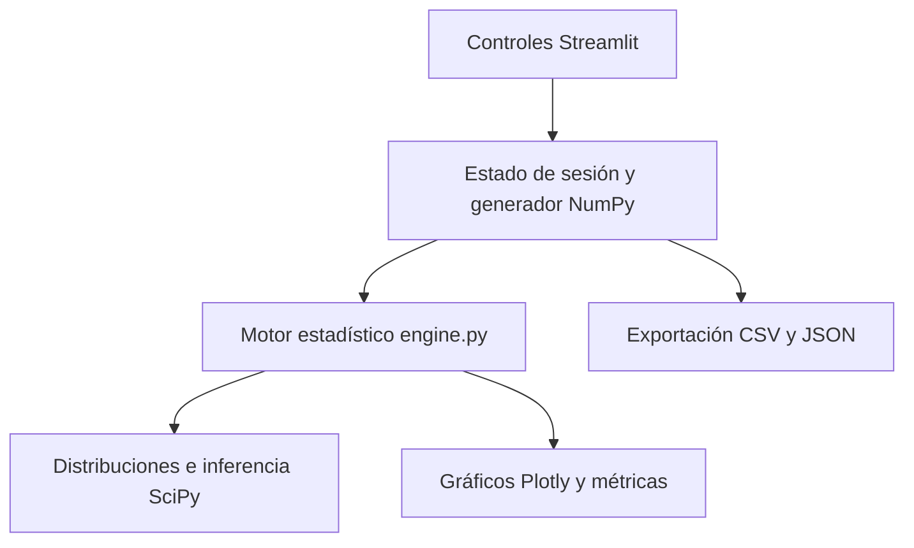

# Casino Estadístico

**El azar se juega. La estadística se comprende.**

Proyecto académico de **Camilo Guevara**. Laboratorio interactivo en español que conecta simulación Monte Carlo, probabilidad, inferencia y visualización. Conserva el enfoque Python + Streamlit + Plotly del proyecto Titanic Survival Analytics.

## Experiencia
- Tres mesas: Binomial, Poisson y Normal.
- Lotes de 1, 10, 100 o 1.000 resultados; piloto automático cada segundo mientras la sesión está abierta.
- Parámetros editables, semilla reproducible y reinicio limpio al cambiar modelo.
- PMF discreta o densidad normal, muestra observada y marcador de última tirada.
- Z-score, media, varianza muestral, historial y convergencia de la media.
- Pausa opcional al terminar un lote con eventos raros; límite de 20.000 resultados por sesión.
- Inferencia de la media: prueba binomial exacta e IC Clopper–Pearson; Poisson por colas iguales e IC Garwood; prueba Z con sigma conocida para Normal.
- CSV con resultados, parámetros, semilla, Z-scores, probabilidades de colas y media acumulada; configuración JSON.

## Ejecutar
Recomendado: Python 3.12.

```bash
python -m venv .venv
# Windows: .venv\Scripts\activate
# macOS/Linux: source .venv/bin/activate
python -m pip install -r requirements.txt
python -m streamlit run app.py
```

## Desplegar como Titanic
En Streamlit Community Cloud, conecta este repositorio y selecciona:
- Rama: `main`
- Archivo principal: `app.py`
- Python: 3.12

No requiere claves, secretos, CSV externos ni una API adicional. `engine.py` es un módulo independiente de la interfaz y puede reutilizarse después en FastAPI. Esta versión no afirma tener un backend REST separado.

## Arquitectura



| Archivo | Responsabilidad |
|---|---|
| `app.py` | Controles, sesión, piloto automático, gráficos y explicaciones |
| `engine.py` | Validación, generación, momentos, rareza, inferencia y exportación |
| `tests/` | Pruebas matemáticas y flujos de UI con Streamlit AppTest |
| `.streamlit/config.toml` | Tema oscuro accesible |

## Criterios estadísticos
Una tirada Binomial es el número de éxitos de n ensayos, no un ensayo único. El tamaño del lote es el número de tiradas. La muestra no se mezcla al cambiar parámetros.

Para Normal se usa probabilidad bilateral exacta de colas. Para Binomial y Poisson: `min(1, 2 min(P(X≤x), P(X≥x)))`. Esta convención incluye x en ambas colas y es conservadora en modelos discretos. El test binomial de toda la muestra utiliza `scipy.stats.binomtest`, cuya definición bilateral por orden de probabilidad es distinta; se etiqueta por separado.

El Z-score es descriptivo. No se convierte a probabilidad normal en modelos discretos. Cuando p=0 o p=1 la varianza es cero, el Z-score no está definido y la UI lo indica.

| Regla Normal bilateral | Probabilidad aproximada |
|---|---|
| ∣Z∣ > 1,96 | 5% |
| ∣Z∣ > 2,5 | 1,24% |
| ∣Z∣ > 2,576 | 1% |

Un evento raro no demuestra sesgo. El IC de la media no es la zona central de resultados individuales. Revisar p-valores repetidamente o detenerse por significación no conserva el error global nominal: la pestaña de inferencia advierte esta limitación. Todos los resultados son simulados, sin apuestas ni dinero real.

## Validación
```bash
python -m pip install pytest
python -m pytest -q
```
18 pruebas pasan en el entorno de desarrollo: momentos y simulación, probabilidades de colas, control conservador de falsas alarmas discretas, límites p=0/1, reproducibilidad, inferencia, cambios de modelo, reinicio y activación del modo automático. AppTest comprueba la lógica, no sustituye una auditoría visual de navegador ni verifica por sí solo el temporizador en un navegador real.

## Limitaciones
- El piloto funciona mientras la sesión de Streamlit está activa; no es un trabajo programado en segundo plano.
- Los datos viven en memoria de sesión; descarga el CSV antes de cerrar.
- El gráfico de convergencia muestra como máximo 1.000 puntos para conservar fluidez; los cálculos y exportaciones usan toda la muestra.
- La interfaz utiliza transiciones Plotly; no representa una animación física de cada ensayo Bernoulli.

## Fuentes
- https://docs.scipy.org/doc/scipy/reference/generated/scipy.stats.binom.html
- https://docs.scipy.org/doc/scipy/reference/generated/scipy.stats.poisson.html
- https://docs.scipy.org/doc/scipy/reference/generated/scipy.stats.norm.html
- https://docs.scipy.org/doc/scipy/reference/generated/scipy.stats.binomtest.html
- https://docs.streamlit.io/develop/api-reference/execution-flow/st.fragment
